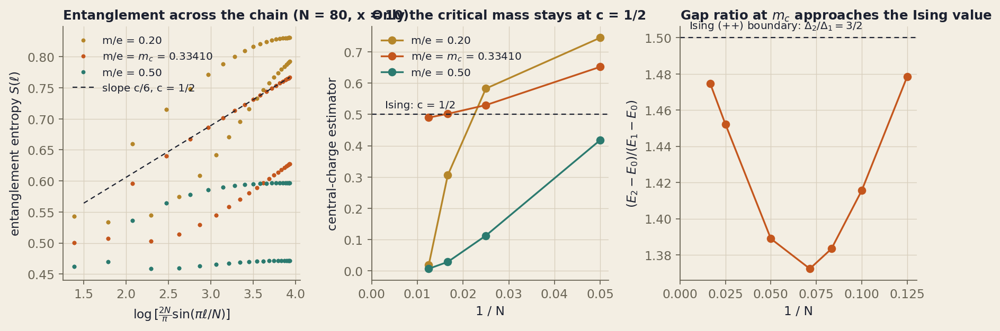
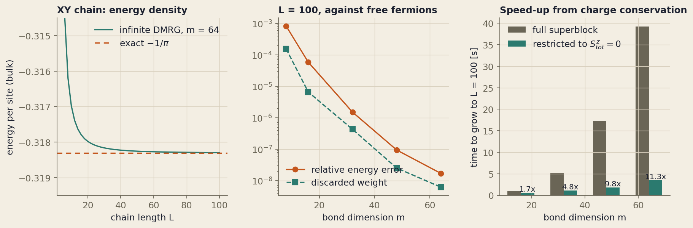

# schwinger-dmrg

The density-matrix renormalization group (DMRG) written from scratch in Python, in White's
original block formulation, with U(1) charge conservation. It is applied to quantum spin chains
and to the massive Schwinger model, 1+1-dimensional QED on a lattice, and every result is
checked against exact solutions.



## What DMRG does

The Hilbert space of a chain of N spins grows as $2^N$, but the low-energy states of 1D
systems with local interactions carry little entanglement. DMRG exploits this. It grows a
chain as

$$[\text{left block}] \bullet \bullet [\text{right block}],$$

finds the ground state of this *superblock* with Lanczos, and keeps only the $m$ most probable
eigenstates of the reduced density matrix of each half. The discarded probability (the
truncation error) controls the accuracy. The infinite-system algorithm grows the chain two sites
at a time; the finite-system algorithm then sweeps back and forth at fixed length until the
energy converges.

When the Hamiltonian conserves a charge, here $S^z_{tot}$, every block state carries a charge
label. The superblock can then be restricted to the target sector and the density matrix
diagonalized sector by sector, which makes DMRG several times faster:



## Models

**XXZ chains** (`XXZChain`):
$H = J\sum_i [\tfrac12(S^+_i S^-_{i+1} + S^-_i S^+_{i+1}) + \Delta S^z_i S^z_{i+1}]$ for any spin $S$.
The XY model ($\Delta = 0$) maps to free fermions and gives an exact benchmark for any $N$; the
Heisenberg model ($\Delta = 1$) has the Bethe-ansatz energy $1/4 - \ln 2$ per site; $S = 1$
gives the Haldane chain.

**The massive Schwinger model** (`SchwingerModel`). On a staggered lattice with the gauge field
eliminated through Gauss's law, the model becomes a spin chain
(conventions of [Arguello Cruz, Tarnopolsky & Xin 2024](https://arxiv.org/abs/2412.01902)):

$$\frac{2H}{e^2a} = \sum_{n=0}^{N-2}\Big(\sum_{k\le n} Q_k + \frac{\theta}{2\pi}\Big)^2
+ \frac{\mu}{2}\sum_n (-1)^n Z_n + x\sum_n (\sigma^+_n\sigma^-_{n+1} + \text{h.c.}),$$

with $Q_k = (Z_k + (-1)^k)/2$, $x = 1/(ea)^2$, and $\mu = 2\sqrt{x}\,m_{\rm lat}/e$, where
$m_{\rm lat} = m - e^2a/8$ is the lattice mass of
[Dempsey et al. (2022)](https://doi.org/10.1103/PhysRevResearch.4.043133).

The Coulomb term is non-local: every link feels all the charge to its left. A block DMRG
handles this by giving each block a few extra operators.

- A **left block** carries its total charge $Q_{\rm tot} = \sum_k Q_k + \theta/2\pi$.
- A **right block** with $n$ internal links carries $P = \sum_{\rm links} p_\ell$, the sum of
  its partial charge sums. With charge $Q_{\rm tot}$ to its left, its Coulomb energy is
  $nQ_{\rm tot}^2 + 2Q_{\rm tot}P + H_C^{\rm right}$, and adding a site with charge $Q$ updates
  $H_C \to H_C + (n+1)Q^2 + 2QP$ and $P \to P + (n+1)Q$.

This is exact, and the tests confirm it against brute-force diagonalization at
$\theta = 0$, $\pi$ and in between.

## The Schwinger model at θ = π

At $\theta = \pi$ the Schwinger model has a second-order phase transition in the 2D Ising
universality class at a critical mass $m_c/e \approx 0.3336$. The figure at the top runs this
code at $x = 10$, using the critical mass $m_c(x{=}10)/e = 0.33410$ computed with lattices of
up to 3000 sites by [Arguello Cruz, Tarnopolsky & Xin](https://arxiv.org/abs/2412.01902).
Two Ising signatures show up:

- **Entanglement.** At criticality the entanglement entropy grows logarithmically with the
  chord length, $S(\ell) = \frac{c}{6}\log[\frac{2N}{\pi}\sin\frac{\pi\ell}{N}] + \dots$, with
  central charge $c = 1/2$. The estimator from their eq. (25) tends to $1/2$ at $m_c$ and to $0$
  in the gapped phases on either side.
- **Spectrum.** The ratio of the first two gaps in the zero-charge sector approaches the Ising
  boundary-CFT value $\Delta_2/\Delta_1 = 3/2$.

These are qualitative checks with $N \le 80$. The precision determination
$m_c/e = 0.333561(4)$ is in the paper.

## Validation

`python -m pytest` runs checks against independent exact results:

- **XY chain.** Matches free fermions for $N$ up to 40, and the error falls as $m$ grows.
- **XXZ chains.** Spin-½ at $\Delta = 1$ and $0.5$, and spin-1, match exact diagonalization.
- **Schwinger model.** Ground and excited energies, and the full entanglement profile
  $S(\ell)$, match exact diagonalization for several $(x, \mu, \theta)$.
- **Bulk energies.** The XY ($-1/\pi$) and Heisenberg ($1/4 - \ln 2$) energies per site are
  reproduced.
- **Symmetry.** Restricting to a charge sector does not change the energy.

## Usage

```python
import numpy as np
from dmrg import SchwingerModel, XXZChain, finite_dmrg

r = finite_dmrg(XXZChain(Delta=1.0), L=60, m=48, sweeps=3)       # Heisenberg chain
print(r.energies[0] / 60)

model = SchwingerModel.from_continuum(x=10.0, m_over_e=0.334, theta=np.pi)
r = finite_dmrg(model, L=40, m=48, sweeps=3, num_states=3)       # lowest three Q = 0 states
gaps = r.energies - r.energies[0]
S = r.entropy_profile                                            # {cut l: S(l)}
```

```
dmrg/models.py    Block; XXZChain; SchwingerModel (with the blockwise Coulomb term)
dmrg/engine.py    infinite_dmrg, finite_dmrg; superblock solve and density-matrix truncation
dmrg/exact.py     free-fermion XY energies and brute-force Hamiltonians for the tests
examples/         make_figures.py regenerates the figures (results cached in examples/data)
tests/            the checks above
```

Requires numpy, scipy and matplotlib. Pure Python, so it is meant for understanding and
for chains of up to about a hundred sites, not for production runs.

## History

I first wrote this in 2022–23 at Carnegie Mellon while learning DMRG with Dr. Grigory
Tarnopolsky, as a set of Jupyter notebooks covering infinite and finite DMRG, the XY,
Heisenberg and spin-1 chains, and charge-sector projection. Their structure followed the
[simple-dmrg](https://github.com/simple-dmrg/simple-dmrg) tutorial by J. R. Garrison and
R. V. Mishmash, from which I learned the method. I then worked on the early stages of the
group's Schwinger-model project, which became
[arXiv:2412.01902](https://arxiv.org/abs/2412.01902).

In 2026 I rewrote the notebooks into this package with help from an AI coding assistant
(Claude). The rewrite:

- generalized the blocks to models whose left and right halves differ;
- added the blockwise treatment of the Schwinger model's Coulomb term;
- added the exact-diagonalization tests and the figures.

## References

- S. R. White, *Density matrix formulation for quantum renormalization groups*,
  [Phys. Rev. Lett. 69, 2863 (1992)](https://doi.org/10.1103/PhysRevLett.69.2863); *Density-matrix
  algorithms for quantum renormalization groups*, [Phys. Rev. B 48, 10345 (1993)](https://doi.org/10.1103/PhysRevB.48.10345).
- U. Schollwöck, *The density-matrix renormalization group in the age of matrix product
  states*, [Ann. Phys. 326, 96 (2011)](https://doi.org/10.1016/j.aop.2010.09.012).
- E. Arguello Cruz, G. Tarnopolsky and Y. Xin, *Precision study of the massive Schwinger
  model near quantum criticality*, [arXiv:2412.01902](https://arxiv.org/abs/2412.01902).
- R. Dempsey, I. R. Klebanov, S. S. Pufu and B. Zan, *Discrete chiral symmetry and mass shift
  in the lattice Hamiltonian approach to the Schwinger model*,
  [Phys. Rev. Research 4, 043133 (2022)](https://doi.org/10.1103/PhysRevResearch.4.043133).
- T. Byrnes, P. Sriganesh, R. J. Bursill and C. J. Hamer, *Density matrix renormalization
  group approach to the massive Schwinger model*, [Phys. Rev. D 66, 013002 (2002)](https://doi.org/10.1103/PhysRevD.66.013002).
- P. Calabrese and J. Cardy, *Entanglement entropy and quantum field theory*,
  [J. Stat. Mech. P06002 (2004)](https://doi.org/10.1088/1742-5468/2004/06/P06002).

## License

MIT. See [LICENSE](LICENSE).
